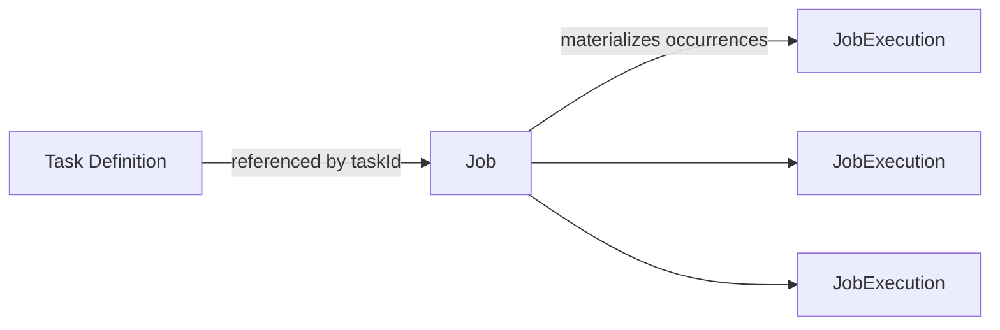
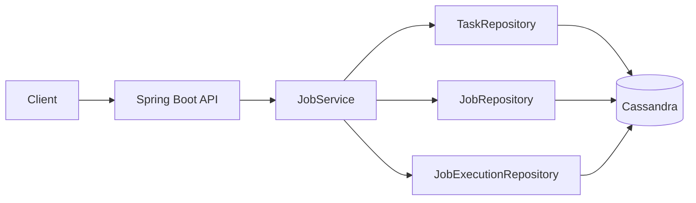
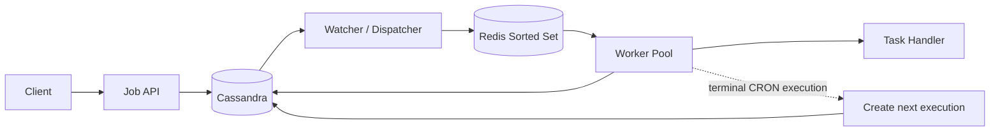
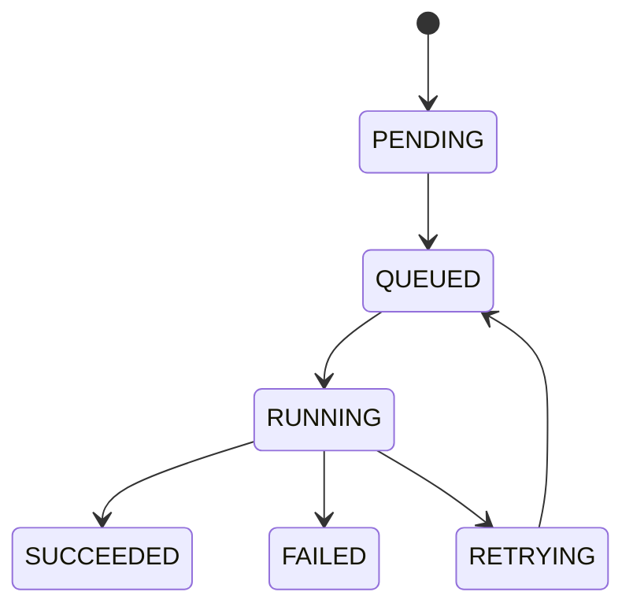

# Distributed Job Scheduler

A personal distributed job-scheduling system for defining reusable **tasks**, creating immutable **jobs**, materializing individual **job executions**, and eventually dispatching due executions to workers with low scheduling latency and at-least-once delivery semantics.

> **Project state captured:** October 25, 2026 (America/New_York)
>
> This documentation separates the **implemented system** from the **target design**. Cassandra persistence, Smithy models, and the create/get job API path are implemented. Redis-based dispatch, watcher/worker processing, retry orchestration, and recurring-execution chaining are the next implementation phase.

---

## 1. Goals

The scheduler is designed around four ideas:

1. A **Task** describes a reusable type of work, such as `send-email`.
2. A **Job** is an immutable configured instance of a task, including parameters and a schedule.
3. A **JobExecution** represents one concrete scheduled occurrence of a job.
4. A dispatch layer moves due executions from durable Cassandra storage into a low-latency Redis priority queue for workers.

The project is intentionally being built from low-level primitives rather than using an existing scheduler so that the design decisions around persistence, time ordering, retries, idempotency, and scaling are explicit.

---

## 2. Functional Requirements

### In scope

- Define reusable tasks and their expected parameters.
- Create/schedule a job.
- Support:
  - one-time schedules;
  - recurring cron schedules.
- Persist jobs durably.
- Materialize each scheduled occurrence as a `JobExecution`.
- Execute jobs close to their scheduled time.
- Monitor execution state.
- Retry failed executions.
- Guarantee **at-least-once** execution.
- Scale the scheduling/dispatch path independently from the API path.

### Explicitly out of scope for the current version

- Updating an existing job.
- DAG/dependency scheduling.
- Exactly-once execution guarantees.
- Arbitrary workflow orchestration.
- User/team authorization and multi-tenancy.

Jobs are intentionally immutable. A changed schedule or parameter set should be represented as a new job rather than an update to an existing job.

---

## 3. Non-Functional Requirements

The original design targets the following system properties:

| Requirement | Target / Design Intent |
|---|---|
| Availability | Prefer availability over immediate consistency for job creation/status reads. |
| Scheduling latency | Execute due jobs within approximately **2 seconds** of their scheduled time where practical. |
| Scale | Design toward approximately **10,000 job executions/second**. |
| Delivery semantics | **At least once**. Duplicate execution is possible during failures/retries. |
| Durability | Job definitions and execution state must survive process restarts. |
| Horizontal scaling | API, watcher/dispatcher, and workers should be independently scalable. |

The 10K executions/sec target is a design target, not a benchmark already demonstrated by the current implementation.

---

## 4. Technology Stack

| Area | Technology |
|---|---|
| Runtime | Java 21 |
| Application framework | Spring Boot |
| Build | Gradle with Kotlin DSL |
| Interface Definition Language | Smithy |
| Durable database | Apache Cassandra |
| Due-work queue / priority queue | Redis Sorted Set *(planned application integration)* |
| Local infrastructure | Docker / Docker Compose |
| Serialization | Jackson + Smithy model support/custom argument resolution |

The repository currently uses Java-focused application code and Gradle Kotlin DSL. Kotlin can be introduced incrementally without requiring a rewrite of the existing Java modules.

---

## 5. Repository Structure

```text
distributed-job-scheduler/
├── build.gradle.kts
├── settings.gradle.kts
├── docker-compose.yml
├── scheduler-model/
│   ├── build.gradle.kts
│   └── src/main/smithy/
│       └── ... Smithy service/model definitions
├── scheduler-api/
│   ├── build.gradle.kts
│   └── src/
│       ├── main/java/.../
│       │   ├── controller/
│       │   ├── service/
│       │   ├── repository/
│       │   ├── config/
│       │   └── mapper/
│       └── test/
└── docs/
    ├── architecture.md
    ├── data-model.md
    ├── api-and-smithy.md
    ├── scheduling-and-execution.md
    ├── failure-semantics.md
    ├── implementation.md
    └── roadmap.md
```

The logical split is:

- **`scheduler-model`** — source of truth for API/domain contracts in Smithy.
- **`scheduler-api`** — Spring Boot HTTP layer and application logic.
- Future scheduler/worker code can initially live inside `scheduler-api` for simplicity, then be split into independently deployable modules/services when scaling or deployment boundaries justify it.

---

## 6. Core Domain Model



### Task

A reusable definition of work.

Example:

```text
Task: send-email
Expected parameters:
- recipient
- subject
- body
- retryCount
```

A task does **not** represent a scheduled occurrence.

### Job

An immutable configured instance of a task.

Example:

```text
Task: send-email
Parameters:
  recipient = user@example.com
  subject = Weekly summary
Schedule:
  CRON 30 15 * * 5
```

### JobExecution

One concrete occurrence of the job, such as:

```text
Job: weekly-email
Execution time: 2026-10-30T15:30:00Z
Status: PENDING
Attempt: 0
```

A recurring job has many executions over its lifetime, but the current design only needs to keep one future occurrence materialized at a time.

---

## 7. High-Level Architecture

### Current implemented path



### Target execution architecture



The database remains the durable source of truth. Redis is not the authoritative store; it is an execution-time ordering/dispatch optimization.

For the detailed component design, see [docs/architecture.md](docs/architecture.md).

---

## 8. Scheduling Strategy

The scheduler avoids repeatedly resolving every cron expression across all jobs.

### One-time job

When a job is created:

1. Validate the task and parameters.
2. Validate the one-time schedule.
3. Persist the immutable job.
4. Create one `PENDING` `JobExecution` at the requested execution time.

After that execution reaches a terminal state, no additional execution is created.

### Cron job — chained recurrence

When a cron job is created:

1. Persist the job.
2. Resolve the first cron occurrence.
3. Create exactly one `PENDING` `JobExecution` for that occurrence.

After the execution completes terminally:

1. Read the job's cron expression.
2. Compute the next cron occurrence after the completed occurrence.
3. Insert exactly one new `PENDING` execution.

This keeps the execution table bounded and removes the need for a separate `next_execution` column/index.

This recurrence-chaining step is part of the target implementation and is not yet wired into the worker path.

See [docs/scheduling-and-execution.md](docs/scheduling-and-execution.md).

---

## 9. Cassandra Data Model

The access pattern drives the Cassandra schema.

The scheduler must efficiently answer:

> Which executions are due around this point in time?

The execution table is therefore time-bucketed and ordered by execution time.

### Tables

```text
tasks
jobs
job_executions
```

The intended execution primary key is:

```sql
PRIMARY KEY ((time_bucket), execution_time, job_id)
```

- `time_bucket` controls partition size and groups executions that are due near each other.
- `execution_time` orders executions inside the bucket.
- `job_id` breaks ties when multiple jobs have the same execution time.

Detailed schema and query patterns are documented in [docs/data-model.md](docs/data-model.md).

---

## 10. Redis Sorted Set Design

A normal FIFO queue is not sufficient because a newly scheduled job may be due before items already in the queue.

Redis Sorted Sets act as a distributed priority queue:

```text
score  = execution timestamp
member = unique execution reference
```

Conceptually:

```text
ZADD scheduler:executions <epochMillis> <jobId>@<executionTime>
```

Workers retrieve executions in score order rather than insertion order.

The Redis container is working locally, including persistence, but the Spring application has not yet integrated the Sorted Set dispatch path.

---

## 11. Execution State Machine

Target state transitions:



Meaning:

- **PENDING** — durable execution exists in Cassandra but has not been dispatched.
- **QUEUED** — execution has been added to Redis for worker consumption.
- **RUNNING** — a worker has started an attempt.
- **RETRYING** — a failed attempt is waiting for another attempt.
- **SUCCEEDED** — terminal success.
- **FAILED** — terminal failure after retry policy is exhausted or the error is non-retryable.

---

## 12. Delivery Semantics

The system is designed for **at-least-once execution**.

Why not exactly once?

A worker can execute the task successfully and fail before persisting `SUCCEEDED`. Another worker may later retry the same execution. Distributed systems cannot reliably distinguish that case without cooperation from the task itself or stronger transactional boundaries.

Therefore:

- the scheduler retries when completion is uncertain;
- task handlers should be **idempotent whenever possible**;
- before starting an execution, the worker should check whether it is already terminal;
- duplicate external side effects must be prevented at the task/business layer when correctness requires it.

See [docs/failure-semantics.md](docs/failure-semantics.md).

---

## 13. API

Implemented API surface currently centers on:

```http
POST /jobs
GET /jobs/{jobId}
```

The request/response domain is generated from Smithy models and consumed by the Spring Boot API.

Example create request:

```json
{
  "name": "weekly-email",
  "taskId": "f822bb44-7e0d-4da6-a0d9-9180fc318bba",
  "parameters": {
    "recipient": "user@example.com",
    "subject": "TESTING IF MY API WORKS",
    "body": "TESTING",
    "retryCount": "3"
  },
  "schedule": {
    "type": "CRON",
    "expression": "30 15 * * 5"
  }
}
```

For full Smithy/API design and serialization notes, see [docs/api-and-smithy.md](docs/api-and-smithy.md).

---

## 14. Cron Handling

The API accepts standard five-field cron expressions such as:

```text
30 15 * * 5
```

Meaning:

```text
minute      = 30
hour        = 15
month day   = *
month       = *
week day    = 5
```

So the job runs at **3:30 PM every Friday**.

Spring cron utilities use a seconds field, so the service layer normalizes a five-field expression before evaluating it, for example:

```text
30 15 * * 5
```

becomes:

```text
0 30 15 * * 5
```

Cron evaluation is performed in UTC in the current design unless an explicit timezone feature is added later.

---

## 15. Local Development

### Prerequisites

- Windows 11 or another Docker-capable development OS
- JDK 21
- IntelliJ IDEA
- Docker Desktop / Docker Compose

### Start infrastructure

From the repository root:

```powershell
docker compose up -d
```

Verify Redis:

```powershell
docker exec -it scheduler-redis redis-cli PING
```

Expected:

```text
PONG
```

Verify Cassandra:

```powershell
docker exec -it scheduler-cassandra cqlsh
```

Then:

```sql
USE scheduler;
DESCRIBE TABLES;
```

Expected logical tables:

```text
tasks
jobs
job_executions
```

### Build

```powershell
.\gradlew.bat clean build
```

Or build an individual module:

```powershell
.\gradlew.bat :scheduler-model:build
.\gradlew.bat :scheduler-api:build
```

---

## 16. Current Implementation Status

| Area | Status |
|---|---|
| Gradle multi-module project | ✅ Implemented |
| Smithy build/code generation | ✅ Implemented |
| Spring Boot API | ✅ Implemented |
| `POST /jobs` | ✅ Implemented |
| `GET /jobs/{jobId}` | ✅ Implemented |
| Smithy input argument resolution | ✅ Implemented |
| Cassandra in Docker | ✅ Implemented |
| Redis in Docker | ✅ Implemented |
| Cassandra `tasks` table | ✅ Implemented |
| Cassandra `jobs` table | ✅ Implemented |
| Cassandra `job_executions` table | ✅ Implemented |
| Cassandra repositories | ✅ Implemented |
| Task parameter validation | ✅ Implemented |
| Schedule validation | ✅ Implemented |
| Initial execution creation | ✅ Implemented |
| Redis application integration | ⏳ Next |
| Watcher / dispatcher | ⏳ Next |
| Worker / task execution | ⏳ Next |
| Retry orchestration | ⏳ Next |
| Cron recurrence chaining | ⏳ Next |
| Multi-instance coordination | ⏳ Future |
| Metrics / tracing / dashboards | ⏳ Future |
| Load testing against 10K exec/s target | ⏳ Future |

---

## 17. Design Documentation

- [Architecture](docs/architecture.md)
- [Data Model](docs/data-model.md)
- [API and Smithy](docs/api-and-smithy.md)
- [Scheduling and Execution](docs/scheduling-and-execution.md)
- [Failure Semantics and Idempotency](docs/failure-semantics.md)
- [Implementation Details](docs/implementation.md)
- [Roadmap](docs/roadmap.md)

---

## 18. Key Design Decisions

1. **Smithy instead of duplicating handwritten API DTOs** — the contract remains centralized and generated models are used at the API boundary.
2. **Jobs are immutable** — no job-update endpoint.
3. **Task → Job → JobExecution separation** — recurring jobs do not overload the job row with execution state.
4. **Cassandra is the durable source of truth** — chosen for predictable write-heavy access patterns and time-keyed execution lookups.
5. **Time-bucketed execution partitions** — prevents a single unbounded time partition while preserving efficient due-work scans.
6. **Redis Sorted Set instead of FIFO/log queue** — due work must be ordered by execution time, not insertion time.
7. **Chained cron recurrence** — materialize only the next occurrence rather than pre-generating a year of executions.
8. **At-least-once semantics** — retries are favored over silently losing work.
9. **Idempotent task design** — the only robust way to tolerate uncertain worker completion without pretending exactly-once execution exists.
10. **Independent scaling boundaries** — API creation traffic, dispatch traffic, and worker execution traffic have different resource profiles.

---

## 19. Next Milestone

The next meaningful end-to-end milestone is:

```text
Create Job
   ↓
Persist Job + first PENDING execution in Cassandra
   ↓
Watcher finds near-future execution
   ↓
Redis Sorted Set orders it by execution time
   ↓
Worker claims and runs it
   ↓
Execution status updated in Cassandra
   ↓
If CRON, materialize exactly one next execution
```

Once that flow works reliably on one application instance, the next step is to make watcher/worker claiming safe under multiple concurrent instances.
