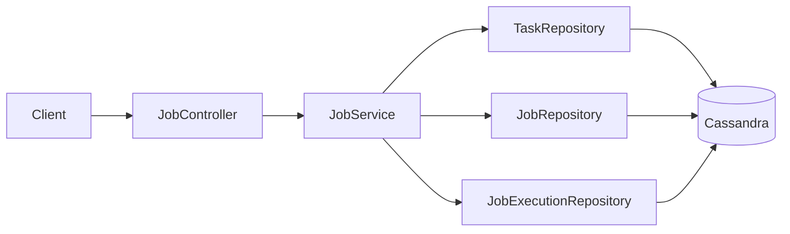
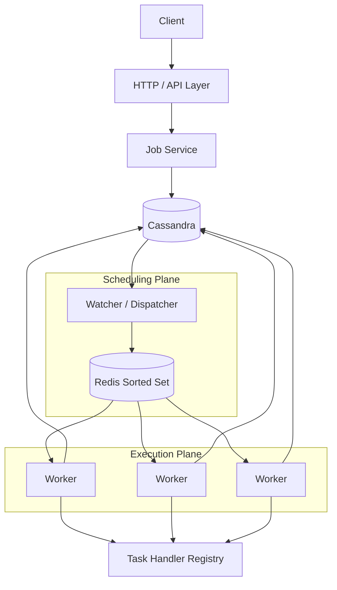

# Architecture

## 1. Architecture Principles

The scheduler is designed around the following separation of responsibilities:

- **API layer:** accepts and validates job definitions.
- **Durable store:** persists tasks, jobs, and execution state.
- **Watcher/dispatcher:** converts future durable work into near-term dispatchable work.
- **Priority queue:** orders work by exact execution time.
- **Workers:** execute task implementations and persist outcomes.

This split exists because the workload characteristics differ significantly:

- API traffic is request/response and comparatively lightweight.
- dispatch is time-sensitive and scan/queue oriented;
- execution may be CPU-, I/O-, or latency-heavy depending on the task.

They should therefore be independently scalable.

---

## 2. Current Architecture



Current responsibilities:

### Controller

- Maps HTTP endpoints.
- Receives Smithy-generated input models.
- Delegates business logic to the service layer.
- Returns Smithy-generated output models.

### JobService

For `createJob`:

1. Validate the referenced task exists.
2. Validate supplied task parameters against the task's parameter schema.
3. Validate the schedule.
4. Persist the immutable `Job`.
5. Resolve the first execution time.
6. Persist the first `JobExecution` with `PENDING` status and `attempt = 0`.
7. Return the created job.

For `getJob`:

1. Parse/validate the API `JobId` string as a UUID.
2. Read the job from Cassandra.
3. Return the Smithy output or raise `JobNotFoundException`.

### Repositories

Repositories use Cassandra/CQL-oriented persistence rather than exposing Cassandra implementation details to controllers.

Logical repository boundaries:

```text
TaskRepository
JobRepository
JobExecutionRepository
```

---

## 3. Target Architecture



---

## 4. Why Cassandra Is the Source of Truth

Redis is deliberately not the authoritative store.

If Redis is lost or restarted, due work must be reconstructable from Cassandra. The watcher can scan durable `PENDING`/retryable executions in relevant time buckets and re-enqueue them.

This provides a clear recovery model:

```text
Cassandra = durable truth
Redis     = scheduling accelerator / priority queue
Worker    = ephemeral compute
```

---

## 5. Why a Watcher Exists

A naive worker could query Cassandra every few seconds for due executions, but at the target scale that produces several problems:

- every worker duplicates due-time queries;
- Cassandra receives repeated polling load;
- large result sets can be returned at once;
- execution-time ordering becomes coupled to database polling latency;
- scaling workers also unintentionally scales Cassandra query pressure.

The watcher separates durable scheduling from execution.

Its job is to maintain a small rolling window of near-future executions in Redis.

Example:

```text
Current time: 15:20
Watcher horizon: +5 minutes

Cassandra query range:
15:20 <= execution_time < 15:25

Result:
PENDING executions are added to Redis with score=execution_time
```

The exact horizon/poll interval are tunable implementation parameters, not part of the public API.

---

## 6. Why Redis Sorted Set

A Kafka-style append-only log or FIFO queue preserves insertion order. That is incorrect for scheduling.

Example:

```text
Queue already contains: execute at 15:10
Newly created job:       execute at 15:05
```

A FIFO queue would place the 15:05 job behind the 15:10 job.

A Sorted Set instead orders by score:

```text
score = scheduled execution timestamp
```

so newly added earlier work automatically moves ahead of later work.

---

## 7. Worker Boundary

The worker should know nothing about HTTP or Smithy transport concerns.

Conceptually:

```java
public interface TaskHandler {
    String taskName();
    void execute(Map<String, String> parameters);
}
```

A registry maps a persisted Task definition to the correct handler implementation.

```text
TaskDefinition(name="send-email")
              ↓
TaskHandlerRegistry
              ↓
SendEmailTaskHandler
```

This keeps scheduler infrastructure generic while allowing concrete work types to be added independently.

The exact handler API can evolve as task requirements become clearer.

---

## 8. Scaling Model

### API layer

Stateless Spring Boot instances can be scaled horizontally behind a load balancer.

### Watcher

Multiple watcher instances require coordination so that the same execution is not repeatedly enqueued unnecessarily. Correctness must still tolerate duplicate enqueue attempts.

Possible future mechanisms include:

- Cassandra conditional claiming;
- Redis atomic operations/scripts;
- lease ownership;
- deterministic idempotent `ZADD` members.

The first implementation can use a single watcher to validate the end-to-end design before introducing distributed coordination.

### Worker pool

Worker throughput should scale independently by adding workers.

Execution correctness must not depend on only one worker existing.

---

## 9. Deployment Evolution

The project does not need microservices on day one.

A sensible progression is:

### Phase 1

Single Spring Boot application containing:

- API;
- watcher;
- worker;
- task handlers.

Cassandra and Redis remain separate infrastructure processes.

### Phase 2

Split worker execution from the API when long-running or high-volume tasks justify it.

### Phase 3

Split watcher/dispatcher if dispatch scaling or operational isolation requires it.

This preserves simple local development while keeping logical boundaries clean from the start.
