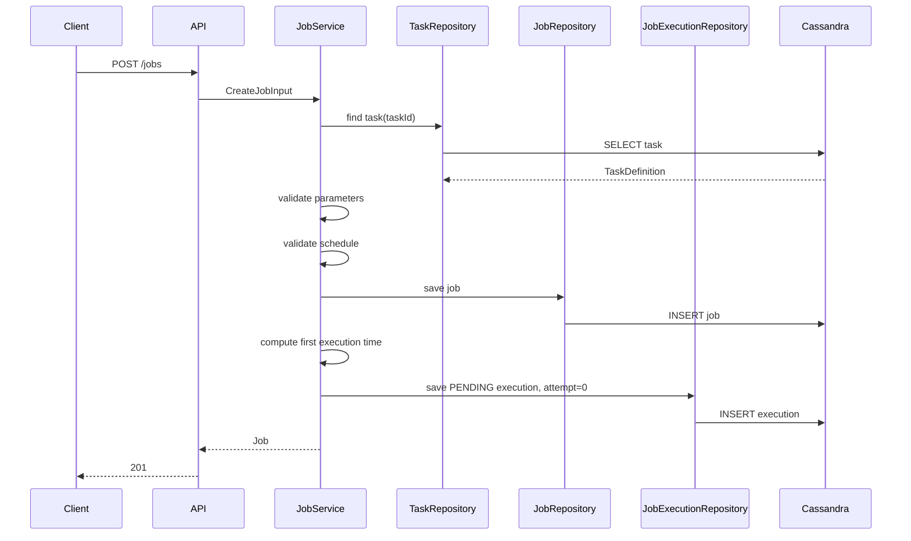
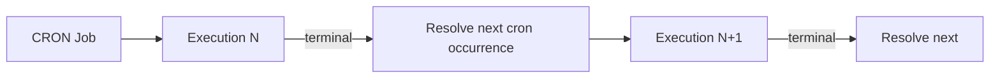

# Scheduling and Execution

## 1. Design Objective

The execution path must answer two separate questions efficiently:

1. **What executions exist durably?** — Cassandra.
2. **Which execution should run next?** — Redis Sorted Set.

Trying to make one component solve both problems creates either expensive database polling or an insufficiently durable queue.

---

## 2. Create-Job Flow

Implemented application flow:



The important property is that a job is not merely configuration: job creation also materializes its first executable occurrence.

---

## 3. First Execution Resolution

### ONE_TIME

Parse `schedule.expression` as an instant.

```text
executionTime = parsed one-time instant
```

### CRON

1. Parse the five-field cron expression.
2. Normalize it to the Spring six-field format by prepending seconds.
3. Calculate the first occurrence after the chosen reference time.

Example:

```text
API expression:    30 15 * * 5
Spring expression: 0 30 15 * * 5
```

Current cron evaluation is UTC-oriented.

---

## 4. Chained Recurrence

The project deliberately moved away from pre-generating many cron occurrences.

### Rejected approach: pre-generation

A weekly cron job could generate 52 rows for a year, but that creates several problems:

- arbitrary planning horizon;
- unnecessary writes;
- cancellation/change cleanup complexity;
- long-lived stale execution rows;
- larger storage footprint.

### Selected approach

Only one future execution is required.



A terminal cron execution creates exactly one next execution.

A terminal one-time execution creates none.

This design also avoids maintaining a separate `next_execution` field or secondary index on the job row.

---

## 5. Watcher / Dispatcher

The watcher is the planned bridge between Cassandra and Redis.

Responsibilities:

1. Determine a near-future scan window.
2. Identify affected Cassandra time buckets.
3. Query executions in the window.
4. Ignore terminal executions.
5. Add eligible executions to the Redis Sorted Set.
6. Update status to `QUEUED` where appropriate.
7. Repeat continuously.

Pseudo-flow:

```text
now = clock.now()
horizon = now + LOOKAHEAD

for bucket in bucketsBetween(now, horizon):
    executions = repository.findBetween(bucket, now, horizon)

    for execution in executions:
        if execution.status is PENDING or RETRYING:
            redis.zadd(queue, executionTime, executionKey)
            mark QUEUED
```

The watcher must be idempotent because it may scan the same time range more than once.

Using a deterministic Redis member means repeated `ZADD` operations update the same member rather than creating unlimited duplicates.

---

## 6. Why Not Poll Every Two Seconds Directly from Workers?

At 10K executions/sec, polling every two seconds could return approximately 20K due executions per scan before overhead and burst effects.

Direct worker polling also creates:

- duplicated scans across workers;
- query amplification against Cassandra;
- large batches that require processing before execution;
- execution delay caused by serialization and scan time;
- coupling between worker scale and database read scale.

The watcher/queue boundary turns a batch lookup problem into an ordered near-real-time dequeue problem.

---

## 7. Redis Queue Representation

Sorted Set:

```text
key: scheduler:executions
```

Score:

```text
executionTime.toEpochMilli()
```

Member:

```text
<jobId>@<executionEpochMillis>
```

Example:

```text
ZADD scheduler:executions 1793374200000 \
  da0d4ae1-0e03-4d58-b2d6-e2221238bfc9@1793374200000
```

Workers query only elements whose score is less than or equal to the current time.

---

## 8. Atomic Claiming

A naive worker implementation is unsafe:

```text
1. ZRANGEBYSCORE due item
2. execute
3. ZREM item
```

Two workers can read the same item between steps 1 and 3.

The multi-worker implementation needs an atomic claim operation.

Possible Redis implementation:

- Lua script that selects one due member and removes/moves it atomically; or
- Redis commands providing equivalent atomic semantics.

The worker should then update Cassandra to `RUNNING` before invoking the task handler.

Even with atomic Redis claiming, the system still remains at-least-once because a worker can fail after performing a task side effect but before persisting completion.

---

## 9. Worker Flow

Target worker algorithm:

```text
1. Atomically claim earliest due Redis member.
2. Load JobExecution from Cassandra.
3. If execution is already SUCCEEDED/FAILED terminal, discard queue item.
4. Load Job.
5. Load TaskDefinition / resolve TaskHandler.
6. Mark execution RUNNING and increment/start attempt metadata.
7. Execute handler.
8. On success:
     a. mark SUCCEEDED
     b. if job is CRON, create exactly one next execution
9. On retryable failure:
     a. calculate backoff
     b. mark RETRYING
     c. requeue using retry timestamp
10. On terminal failure:
     a. mark FAILED
```

---

## 10. Retry Scheduling

Retries should use exponential backoff rather than immediate tight-loop re-execution.

Conceptually:

```text
retryDelay = min(baseDelay * 2^attempt, maxDelay)
retryAt    = now + retryDelay
```

The same Sorted Set can schedule retries because its semantics are time-based.

```text
ZADD scheduler:executions retryAt executionKey
```

The scheduler therefore does not need a separate retry queue initially.

---

## 11. Long-Running Tasks and Leases

A worker can disappear after claiming an item.

A later phase should introduce a lease/visibility concept:

```text
claimed at:       15:00:00
lease expiration: 15:05:00
```

If completion has not been persisted before the lease expires, the execution becomes eligible for recovery/retry.

A lease is better than relying on active health-check pings for every worker because worker-health monitoring alone can generate significant network chatter and does not by itself prove the state of a specific execution.

---

## 12. Startup Recovery

On process restart:

- `PENDING` executions remain discoverable in Cassandra;
- Redis queue contents can be reconstructed;
- `RUNNING` executions with expired leases can be returned to retry processing;
- terminal executions remain terminal.

This is the central durability advantage of keeping Cassandra authoritative.

---

## 13. Late Executions

The scheduler should never discard an execution merely because its scheduled time has passed.

A due scan is logically:

```text
execution_time <= now
```

subject to bounded recovery windows/buckets.

A delayed execution should run late rather than disappear, preserving at-least-once semantics.

Metrics should separately measure scheduling delay:

```text
startDelay = startedAt - executionTime
```

so lateness is visible operationally.
